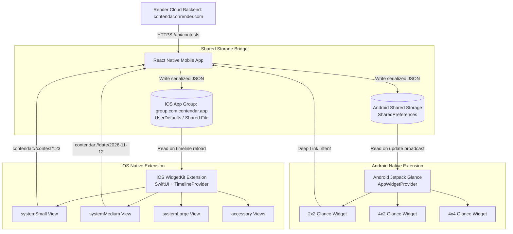
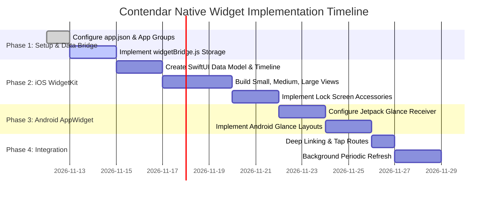

# Contendar Native Widget Architecture & Implementation Guide

> **Target Ecosystems:** iOS 17/18+ (WidgetKit, SwiftUI, App Groups, Lock Screen, StandBy) & Android 12+ (Jetpack Glance, RemoteViews, AppWidgetProvider)  
> **App Framework:** React Native (Expo SDK 58)  
> **Design Language:** Apple Human Interface Guidelines (OLED Black, System Tints, SF Typography, Tabular Digits)

---

## 1. Executive Summary & Vision

The goal is to extend the **Contendar Calendar & Chrono-Radar** from the native React Native application directly onto the user's **Home Screen**, **Lock Screen**, and **StandBy mode** (iOS) and **Android Home Screen**.

Just like Apple's native Calendar and Fitness widgets:
- Users should be able to see **today's scheduled competitive programming rounds** at a glance.
- If a contest is **LIVE**, the widget should pulse with Apple Red (`#FF453A`), showing the elapsed time and remaining duration.
- The **Medium** and **Large** widgets render a clean monthly calendar matrix with platform micro-dots (Codeforces, LeetCode, CodeChef, AtCoder).
- Tapping any contest or date deep-links directly into the native app via `contendar://contest/:id` or `contendar://date/:isoDate` and immediately opens the corresponding sheet.

---

## 2. Widget Form Factors & Layout Matrix

| Widget Size | Platform | Content & Layout |
| :--- | :--- | :--- |
| **Small (`systemSmall`)**<br>2 × 2 | iOS & Android | • **Single Focus**: Next upcoming contest or active LIVE round.<br>• Large tabular countdown (`in 42m` or `LIVE 1h 12m`).<br>• Platform icon + name + division pill.<br>• Today's date pill on the top right. |
| **Medium (`systemMedium`)**<br>4 × 2 | iOS & Android | • **Split View**: Left side has 7-day horizontal calendar strip with contest indicator dots.<br>• Right side has Next / Live round summary with direct "Arena" link. |
| **Large (`systemLarge`)**<br>4 × 4 | iOS & Android | • **Full Calendar + Agenda**: Top half renders the full monthly calendar matrix (S M T W T F S) with platform dots.<br>• Bottom half renders an Inset Grouped list of today's / tomorrow's scheduled rounds. |
| **Lock Screen (`accessoryRectangular`)** | iOS Lock Screen | • Two-line compact view: Next contest title + countdown ticker. |
| **Lock Screen (`accessoryCircular`)** | iOS Lock Screen | • Circular gauge showing countdown to next contest or progress of active round. |
| **Lock Screen (`accessoryInline`)** | iOS Lock Screen | • Single line above the clock: `⚡ CF Round 980 in 2h 15m`. |

---

## 3. High-Level Architecture & Data Flow



---

## 4. Shared Data Contract (JSON Payload)

To ensure high performance and zero dependency overhead between React Native, SwiftUI, and Kotlin, the React Native app serializes contest feeds into a lightweight, self-contained JSON stored in the shared App Group.

### JSON Storage Schema (`contendar_widget_data.json`):
```json
{
  "updatedAtMs": 1731332400000,
  "timezone": "local",
  "activeLiveRound": {
    "id": "cf-980-div2",
    "title": "Codeforces Round 980 (Div. 2)",
    "platform": "codeforces",
    "platformName": "Codeforces",
    "platformColor": "#3B82F6",
    "startTimeMs": 1731331200000,
    "endTimeMs": 1731338400000,
    "durationSeconds": 7200,
    "url": "https://codeforces.com/contest/980"
  },
  "nextUpcomingRound": {
    "id": "lc-weekly-423",
    "title": "Weekly Contest 423",
    "platform": "leetcode",
    "platformName": "LeetCode",
    "platformColor": "#F59E0B",
    "startTimeMs": 1731376800000,
    "endTimeMs": 1731382200000,
    "durationSeconds": 5400,
    "url": "https://leetcode.com/contest/weekly-contest-423"
  },
  "todayContests": [
    {
      "id": "cf-980-div2",
      "title": "Codeforces Round 980 (Div. 2)",
      "platform": "codeforces",
      "platformName": "Codeforces",
      "platformColor": "#3B82F6",
      "startTimeMs": 1731331200000,
      "durationSeconds": 7200,
      "status": "LIVE"
    }
  ],
  "calendarDots": {
    "2026-11-11": ["#3B82F6", "#F59E0B"],
    "2026-11-12": ["#A855F7"],
    "2026-11-15": ["#06B6D4", "#3B82F6"]
  }
}
```

---

## 5. Technical Implementation in Expo (Step-by-Step)

### Step 1: Configure App Groups & Deep Linking in `app.json`

Add iOS entitlements for App Groups and Android package settings in [`native/app.json`](file:///d:/Projects/ContestCalender/native/app.json):

```json
{
  "expo": {
    "name": "CONTENDAR",
    "slug": "contendar",
    "scheme": "contendar",
    "ios": {
      "bundleIdentifier": "com.contendar.app",
      "entitlements": {
        "com.apple.security.application-groups": [
          "group.com.contendar.app"
        ]
      }
    },
    "android": {
      "package": "com.contendar.app"
    }
  }
}
```

---

### Step 2: React Native Shared Storage Bridge Module

Create [`native/src/services/widgetBridge.js`](file:///d:/Projects/ContestCalender/native/src/services/widgetBridge.js) to serialize contest data and notify native widgets whenever contests are fetched or refreshed.

```javascript
import { Platform } from 'react-native';
import * as Linking from 'expo-linking';
import SharedGroupPreferences from 'react-native-shared-group-preferences';

const APP_GROUP_ID = 'group.com.contendar.app';
const WIDGET_DATA_KEY = 'contendar_widget_data';

/**
 * Updates shared storage and triggers widget timeline refresh
 */
export async function syncContestsToWidget(contests, timezone = 'local') {
  try {
    const liveRound = contests.find(c => c.status === 'LIVE') || null;
    const upcoming = contests
      .filter(c => c.status === 'UPCOMING')
      .sort((a, b) => a.startTimeMs - b.startTimeMs)[0] || null;

    // Map dates to platform dot colors for the calendar matrix
    const calendarDots = {};
    contests.forEach(c => {
      const dateKey = new Date(c.startTimeMs).toISOString().split('T')[0];
      if (!calendarDots[dateKey]) calendarDots[dateKey] = [];
      const color = c.platformColor || '#0A84FF';
      if (!calendarDots[dateKey].includes(color) && calendarDots[dateKey].length < 3) {
        calendarDots[dateKey].push(color);
      }
    });

    const payload = {
      updatedAtMs: Date.now(),
      timezone,
      activeLiveRound: liveRound,
      nextUpcomingRound: upcoming,
      todayContests: contests.filter(c => isToday(c.startTimeMs)).slice(0, 4),
      calendarDots
    };

    if (Platform.OS === 'ios') {
      await SharedGroupPreferences.setItem(WIDGET_DATA_KEY, payload, APP_GROUP_ID);
      // Trigger WidgetKit reload if native bridge module exists
    } else if (Platform.OS === 'android') {
      // Android SharedPreferences bridge
    }
  } catch (err) {
    console.warn('Widget sync error:', err);
  }
}
```

---

### Step 3: iOS WidgetKit Target (SwiftUI)

We create an iOS Target `ContendarWidget` using SwiftUI.

#### 1. Data Model (`WidgetData.swift`)
```swift
import Foundation

struct WidgetContest: Codable {
    let id: String
    let title: String
    let platform: String
    let platformName: String
    let platformColor: String
    let startTimeMs: Double
    let endTimeMs: Double?
    let durationSeconds: Int
    let url: String?
}

struct WidgetPayload: Codable {
    let updatedAtMs: Double
    let timezone: String
    let activeLiveRound: WidgetContest?
    let nextUpcomingRound: WidgetContest?
    let todayContests: [WidgetContest]
    let calendarDots: [String: [String]]
}
```

#### 2. Timeline Provider (`ContestTimelineProvider.swift`)
```swift
import WidgetKit
import SwiftUI

struct ContestEntry: TimelineEntry {
    let date: Date
    let payload: WidgetPayload?
}

struct ContestTimelineProvider: TimelineProvider {
    let appGroupId = "group.com.contendar.app"
    let storageKey = "contendar_widget_data"

    func placeholder(in context: Context) -> ContestEntry {
        ContestEntry(date: Date(), payload: nil)
    }

    func getSnapshot(in context: Context, completion: @escaping (ContestEntry) -> Void) {
        completion(ContestEntry(date: Date(), payload: loadData()))
    }

    func getTimeline(in context: Context, completion: @escaping (Timeline<ContestEntry>) -> Void) {
        let data = loadData()
        let currentDate = Date()
        
        // Refresh every 15 minutes or when the next contest starts
        var nextRefresh = Calendar.current.date(byAdding: .minute, value: 15, to: currentDate)!
        if let upcoming = data?.nextUpcomingRound {
            let contestStart = Date(timeIntervalSince1970: upcoming.startTimeMs / 1000)
            if contestStart > currentDate && contestStart < nextRefresh {
                nextRefresh = contestStart
            }
        }

        let entry = ContestEntry(date: currentDate, payload: data)
        let timeline = Timeline(entries: [entry], policy: .after(nextRefresh))
        completion(timeline)
    }

    private func loadData() -> WidgetPayload? {
        guard let userDefaults = UserDefaults(suiteName: appGroupId),
              let jsonString = userDefaults.string(forKey: storageKey),
              let jsonData = jsonString.data(using: .utf8) else {
            return nil
        }
        return try? JSONDecoder().decode(WidgetPayload.self, from: jsonData)
    }
}
```

#### 3. SwiftUI Views (`ContendarWidgetViews.swift`)

##### A. Small Widget (`systemSmall`):
```swift
struct SmallWidgetView: View {
    let entry: ContestEntry

    var body: some View {
        ZStack {
            Color.black

            if let live = entry.payload?.activeLiveRound {
                VStack(alignment: .leading, spacing: 6) {
                    HStack {
                        Circle().fill(Color.red).frame(width: 6, height: 6)
                        Text("LIVE NOW")
                            .font(.system(size: 10, weight: .bold))
                            .foregroundColor(.red)
                        Spacer()
                    }

                    Text(live.title)
                        .font(.system(size: 13, weight: .bold))
                        .foregroundColor(.white)
                        .lineLimit(2)

                    Spacer()

                    Text(live.platformName)
                        .font(.system(size: 11, weight: .semibold))
                        .foregroundColor(Color(hex: live.platformColor))
                }
                .padding(12)
            } else if let next = entry.payload?.nextUpcomingRound {
                VStack(alignment: .leading, spacing: 6) {
                    HStack {
                        Circle().fill(Color.blue).frame(width: 6, height: 6)
                        Text("UP NEXT")
                            .font(.system(size: 10, weight: .bold))
                            .foregroundColor(.blue)
                        Spacer()
                    }

                    Text(next.title)
                        .font(.system(size: 13, weight: .bold))
                        .foregroundColor(.white)
                        .lineLimit(2)

                    Spacer()

                    Text(Date(timeIntervalSince1970: next.startTimeMs / 1000), style: .relative)
                        .font(.system(size: 12, weight: .semibold, design: .monospaced))
                        .foregroundColor(.white)
                }
                .padding(12)
            } else {
                Text("No Rounds")
                    .font(.system(size: 13, weight: .medium))
                    .foregroundColor(.gray)
            }
        }
        .widgetURL(URL(string: "contendar://"))
    }
}
```

##### B. Medium Widget (`systemMedium`):
- Left side: 7-day mini horizontal calendar with today's electric blue bubble and colored micro-dots.
- Right side: Inset card for next contest with platform icon, countdown, and deep-link.

##### C. Large Widget (`systemLarge`):
- Full monthly calendar matrix (S M T W T F S) matching `CalendarView.jsx`.
- Inset grouped list of today's rounds at the bottom.

---

### Step 4: Deep Linking in React Native (`App.js`)

When the user taps a round in the widget, iOS passes `contendar://contest/{contestId}` to the React Native app.

In [`native/App.js`](file:///d:/Projects/ContestCalender/native/App.js):
```javascript
import * as Linking from 'expo-linking';

// Inside App component:
useEffect(() => {
  const handleDeepLink = (event) => {
    const data = Linking.parse(event.url);
    if (data.hostname === 'contest' || data.path?.includes('contest')) {
      const contestId = data.queryParams?.id || data.path?.split('/').pop();
      const target = allContests.find(c => c.id === contestId);
      if (target) setSelectedContest(target);
    } else if (data.hostname === 'date' || data.path?.includes('date')) {
      const dateStr = data.queryParams?.date || data.path?.split('/').pop();
      // Inspect selected day
    }
  };

  const sub = Linking.addEventListener('url', handleDeepLink);
  Linking.getInitialURL().then(url => {
    if (url) handleDeepLink({ url });
  });

  return () => sub.remove();
}, [allContests]);
```

---

## 6. Implementation Roadmap & Execution Plan



---

## 7. Next Steps to Begin Coding

1. **Enable App Group in `app.json`**: Register `group.com.contendar.app` and custom scheme `contendar`.
2. **Create the Data Bridge Service**: Install `react-native-shared-group-preferences` and hook it into `loadData()` in `App.js`.
3. **Prebuild Native Directories**: Run `npx expo prebuild` to generate the native `ios/` and `android/` projects.
4. **Add the WidgetKit Target in Xcode**: Add the SwiftUI views and timeline provider.
5. **Verify on iOS Simulator**: Add the widget to the Home Screen and verify real-time contest syncing.

